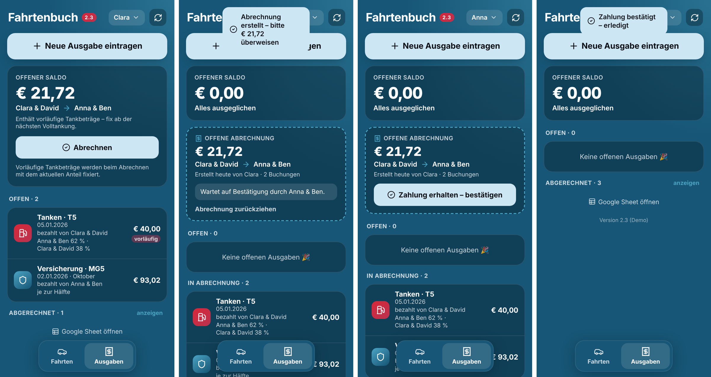
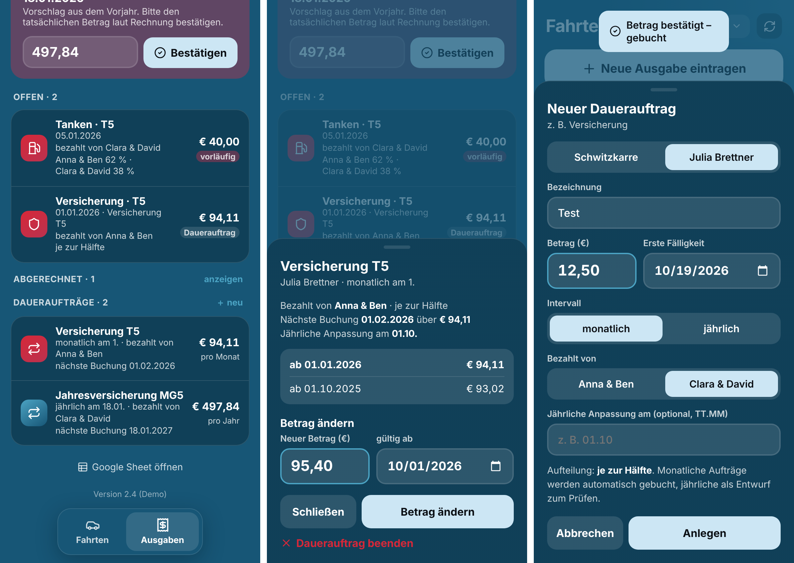
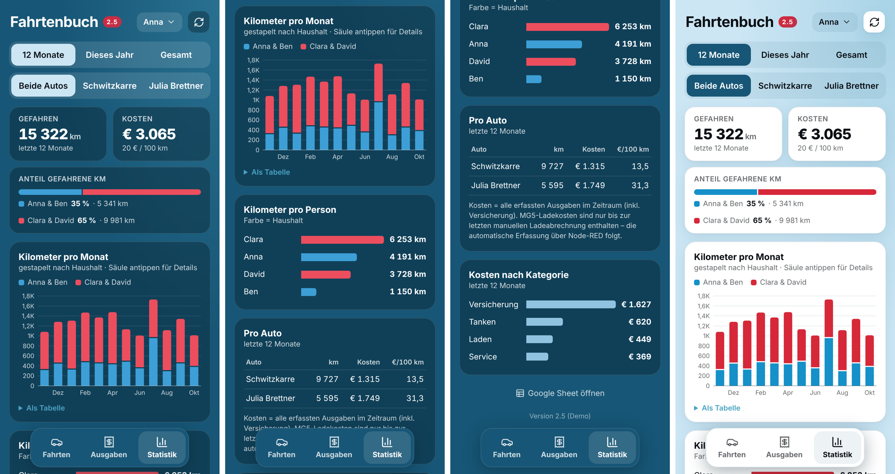
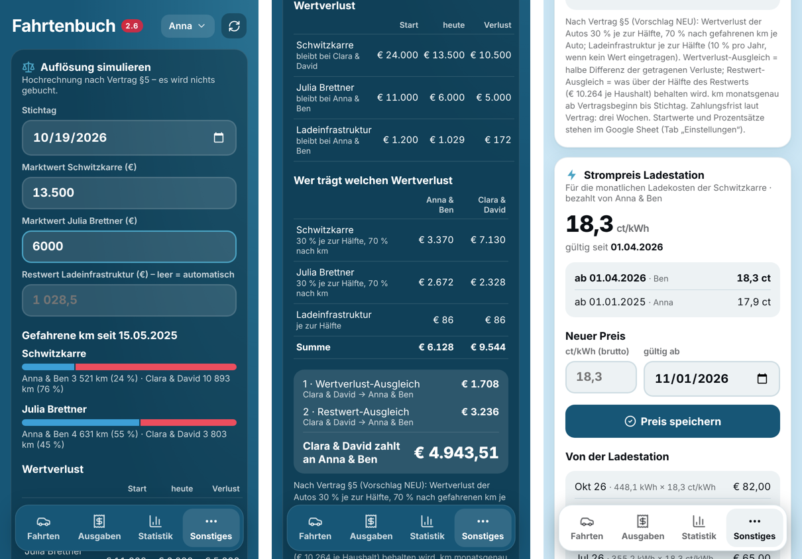

# 🚗 Fahrtenbuch Autogemeinschaft

Web-App für das gemeinsame Fahrtenbuch zweier Haushalte mit zwei geteilten Autos – einem Elektroauto (MG5, „Schwitzkarre") und einem VW T5 („Julia Brettner").
Fahrten und Ausgaben werden am Handy erfasst, die Kosten automatisch nach Vertrag aufgeteilt.

**👉 App: [paulrigger.github.io/fahrtenbuch](https://paulrigger.github.io/fahrtenbuch/)** · [Demo mit Beispieldaten](https://paulrigger.github.io/fahrtenbuch/?demo)
<sub>Für echte Daten den Link mit Zugangsschlüssel (`?k=…`) aus der Gruppe verwenden.</sub>


> Screenshots zeigen Demo-Daten. Echte Daten liegen ausschließlich im privaten Google Sheet.

---

## Inhalt

- [Funktionen](#funktionen)
- [Screenshots](#screenshots)
- [So werden Kosten aufgeteilt](#so-werden-kosten-aufgeteilt)
- [Für Mitfahrende: App einrichten](#für-mitfahrende-app-einrichten)
- [Architektur](#architektur)
- [Einrichtung & Betrieb](#einrichtung--betrieb)
- [API](#api)
- [Datenmodell](#datenmodell)
- [Entwicklung](#entwicklung)
- [Roadmap](#roadmap)

---

## Funktionen

**Fahrten**
- Fahrt **starten** und später **beenden** – oder **direkt eintragen** (Start + Ende in einem Schritt)
- Gefahrene km werden **live berechnet**; Plausibilitätsprüfung (Ende < Start, Lücken, > 3.000 km)
- Status pro Auto: zuhause / unterwegs (mit wem, seit wann), letzter km-Stand
- MG5: **Akkustand und Reichweite** (aus dem Smarthome, Tab `MG5-Data`)
- Spalte „Differenz" wird als Formel `=Cx-Bx` geschrieben → Korrekturen rechnen automatisch durch
- Bedienung auch per **Siri / Apple-Kurzbefehle** (über die bestehende Apps-Script-Web-App)

**Ausgaben** *(ab v2.2)*
- Tanken, Versicherung, Service, Reifen, Schaden, Sonstiges erfassen
- **Tanken** wird automatisch **nach gefahrenen km zwischen zwei Volltankungen** aufgeteilt
- **Offener Saldo**: wer schuldet wem wie viel
- Live-Vorschau der Aufteilung im Formular; Bearbeiten und Löschen offener Buchungen
- Alle Altbuchungen migriert (fixe Anteile, Status offen / abgerechnet)

**Abrechnung** *(ab v2.3)*
- Knopf **„Abrechnen"** in der Saldo-Kachel – nur für die zahlende Seite
- Saldo geht auf 0, es entsteht eine Kachel **„Offene Abrechnung"**
- Die empfangende Seite **bestätigt den Erhalt** → Buchungen sind quittiert, Kachel verschwindet
- Die zahlende Seite kann eine noch offene Abrechnung **zurückziehen**
- km-Anteile vorläufiger Tankungen werden beim Abrechnen fixiert



**Daueraufträge** *(ab v2.4)*
- Für wiederkehrende Fixkosten (Versicherung) – wie ein Dauerauftrag am Konto
- **Monatlich** → wird am Fälligkeitstag automatisch gebucht
- **Jährlich** → erscheint als **Entwurf „Betrag prüfen"**; die zahlende Seite bestätigt/korrigiert den Betrag laut Rechnung (wird für Folgejahre übernommen)
- **Betrag ändern ab …** legt eine neue Preisstufe an (Historie bleibt sichtbar); bereits erzeugte, offene Buchungen ab dem Datum werden angepasst
- **Erinnerung** einen Monat vor der jährlichen Anpassung (z. B. 1.10.), bis der neue Betrag eingetragen ist
- Buchungen aus Daueraufträgen sind bearbeitbar, aber nicht löschbar (stattdessen Auftrag ändern/beenden)



**Statistik** *(ab v2.5)*
- Dritter Reiter mit Zeitraum (12 Monate / dieses Jahr / gesamt) und Auto-Filter
- Kennzahlen: gefahrene km, Kosten, €/100 km, Anteil der Haushalte
- km pro Monat (gestapelt nach Haushalt, antippen für Details, auch als Tabelle), km pro Person, Kosten pro Auto mit Aufschlüsselung nach Kategorie (Balken, Anteil, Betrag, €/100 km) und Kosten nach Kategorie



**Sonstiges** *(ab v2.6, Menü mit Unterseiten)*
- **Fahrtenbuch** *(v2.7)*: alle Einträge je Auto, Lücken und Überschneidungen markiert, unbekannte Fahrer:innen; Einträge bearbeiten/löschen, Lücke mit einem Tipp als Fahrt eintragen
- **Auflösung simulieren** nach Vertrag §5: zwei Marktwerte eintragen (Restwert der Ladeinfrastruktur wird automatisch mit 10 %/Jahr gerechnet oder überschrieben). Wertverlust der Autos 30 % je zur Hälfte, 70 % nach km je Auto seit Vertragsbeginn; daraus Wertverlust- und Restwert-Ausgleich und die Gesamtzahlung zwischen den Haushalten. Nur Hochrechnung, es wird nichts gebucht.
- **Strompreis der Ladestation** in ct/kWh mit „gültig ab“ (Historie bleibt)
- **Ladekosten automatisch**: Node-RED schickt einmal im Monat den Verbrauch der Ladestation; daraus entsteht die Buchung „Laden“ (kWh × Preis), aufgeteilt nach den km der Schwitzkarre im jeweiligen Monat
- Link zum Google Sheet und zum Vertrag (nur noch hier)
- **Siri-Kurzbefehle** zum Laden (iCloud-Links aus dem Tab „Einstellungen“, Zeilen `Kurzbefehl <Name>`)



**Allgemein**
- Als **App auf dem Home-Bildschirm** installierbar (eigenes Icon, kein Browser-Rahmen, kein Google-Banner)
- **Hell- und Dunkelmodus** folgen der Systemeinstellung
- Einmalige Namensauswahl pro Gerät; Zugriff nur mit Zugangsschlüssel im Link

---

## Screenshots

| | Dunkel | Hell |
|---|---|---|
| **Start** |  |  |
| **Fahrt eintragen** |  |  |
| **Ausgaben & Saldo** |  |  |
| **Tanken eintragen** |  |  |
| **Aufteilungs-Vorschau** |  |  |
| **Namensauswahl** |  |  |

---

## So werden Kosten aufgeteilt

Grundlage ist der Vertrag zur gemeinschaftlichen Nutzung (§3). Abgerechnet wird zwischen den beiden **Haushalten** – wer tankt oder zahlt, legt aus der Haushaltskasse aus. In App und Sheet stehen die Haushalte ausgeschrieben (z. B. „Anna & Ben"); intern verwendet die API die Kürzel `PK` / `TM`.

| Kategorie | Fahrzeug | Aufteilung |
|---|---|---|
| ⛽ Tanken | T5 | nach km zwischen zwei Volltankungen |
| 🛡️ Versicherung | beide | 50 : 50 – **nur über Daueraufträge** |
| 🔧 Service / Reparatur | beide | 50 : 50 (pro Buchung änderbar) |
| 💥 Schaden | beide | 100 % Verursacher-Haushalt |
| 📦 Sonstiges | beide | wählbar: je zur Hälfte / nur einer der Haushalte |

Vignette, ÖAMTC u. Ä. zahlt jeder Haushalt selbst je zur Hälfte – sie werden nicht erfasst.
| 🔌 Laden MG5 | MG5 | *derzeit nur Altdaten – künftig automatisch über Node-RED* |

### Tanken: Aufteilung nach km

```
 Volltankung        Teiltankung        Volltankung
 km 50.000  ──────  km 50.320  ──────  km 50.600
     │                   │                   │
     └──── 600 km: PK 264 km (44 %) · TM 336 km (56 %) ────┘
           Beide Tankbeträge werden 44 : 56 aufgeteilt.
```

- Maßgeblich ist der **km-Stand beim Tanken** (nicht das Datum); Fahrten über eine Tankgrenze werden anteilig gezählt.
- Tankungen nach der letzten Volltankung sind **vorläufig** und werden bei der nächsten Volltankung fixiert.
- Startpunkt der neuen Logik ist eine **Anker-Volltankung** aus den Altdaten.

### Saldo

Pro Buchung: zahlt PK, schuldet TM den TM-Anteil – und umgekehrt. Der offene Saldo ist die Summe über alle Buchungen mit Status `offen`.
Ein positiver Wert bedeutet *TM schuldet PK*, ein negativer *PK schuldet TM*.

---

## Für Mitfahrende: App einrichten

1. Den **Link aus der Gruppe** öffnen (enthält `?k=…`).
2. Einmal den **eigenen Namen** wählen.
3. iPhone: **Teilen → „Zum Home-Bildschirm"**. Die installierte App hat eigenen Speicher – dort den Namen einmal neu wählen.
4. Name ändern: oben rechts auf den Namen tippen.

---

## Architektur

```
 ┌──────────────────────────┐        fetch (JSON)       ┌──────────────────────────┐
 │  GitHub Pages            │ ────────────────────────▶ │  Apps Script             │
 │  index.html (diese Repo) │   ?key=… / POST text/plain │  „Fahrtenbuch API"       │
 │  PWA, Hell/Dunkel        │ ◀──────────────────────── │  api/Code.gs             │
 └──────────────────────────┘                            │  ausgeführt als Besitzer │
                                                         └────────────┬─────────────┘
 ┌──────────────────────────┐                                         │
 │  Apps Script             │  Siri / Kurzbefehle                     ▼
 │  „Fahrtenbuch" (alt)     │ ─────────────────────────▶  ┌──────────────────────────┐
 │  doPost für Shortcuts    │                             │  Google Sheet (privat)   │
 └──────────────────────────┘                             │  Fahrtenbücher, Buchungen│
 ┌──────────────────────────┐   MG5-Akku/Reichweite       │  MG5-Data, Summen …      │
 │  Smarthome (Node-RED)    │ ─────────────────────────▶  └──────────────────────────┘
 └──────────────────────────┘
```

- **Frontend**: eine einzige `index.html` ohne Build-Schritt, Icons als Inline-SVG, Schrift SF Pro (Apple) bzw. Inter.
- **API**: eigenes Apps-Script-Projekt, *Ausführen als: Ich*, *Zugriff: Jeder*, geschützt über einen Schlüssel.
- **Daten**: ausschließlich im privaten Google Sheet. Im Repo stehen weder Daten noch Schlüssel noch Sheet-ID.
- Die alte Apps-Script-Web-App bleibt für Siri-Kurzbefehle parallel in Betrieb.

---

## Einrichtung & Betrieb

### API-Projekt (einmalig)

1. [script.new](https://script.new) → Projekt **Fahrtenbuch API**.
2. Inhalt von [`api/Code.gs`](api/Code.gs) einfügen.
3. ⚙️ Projekteinstellungen:
   - Zeitzone **Europe/Vienna**
   - Skripteigenschaft **`SHEET_ID`** = ID des Google Sheets (aus der Sheet-URL zwischen `/d/` und `/edit`)
   - Skripteigenschaft **`HOUSEHOLDS`** = Personen und Haushalte als JSON, z. B.
     `{"Anna":"PK","Ben":"PK","Clara":"TM","David":"TM"}`
4. Funktion **`setup`** ausführen → `API_KEY` steht im Ausführungsprotokoll.
5. **Bereitstellen → Neue Bereitstellung → Web-App**: Ausführen als **Ich**, Zugriff **Jeder**.
6. `/exec`-URL in `index.html` bei `API_URL` eintragen.

### Update der API

1. Neuen `api/Code.gs` einfügen und speichern.
2. Bei Änderungen an Ausgaben einmal **`recomputeExpenses`** ausführen (einmalig bei v2.2: **`migrateLabels`** – schreibt die Haushalte im Sheet aus).
3. **Bereitstellungen verwalten → ✏️ → Neue Version** (URL bleibt gleich).

### Update der Oberfläche

Push auf `main` → GitHub Pages veröffentlicht automatisch nach ~1 Minute.

### Schlüssel wechseln

Skripteigenschaft `API_KEY` löschen → `setup` ausführen → neuen Link verteilen.

---

## API

Alle Antworten sind JSON, Fehler immer als `{ "ok": false, "error": "…" }`.

### GET

| Aufruf | Antwort |
|---|---|
| `?key=…&action=all` | `version`, `drivers`, `households`, `hhLabels`, `sheetUrl`, `cars[]` |
| `?key=…&action=stats` | `trips[{m, car, p, h, km}]`, `costs[{m, car, cat, amount}]` (Monatswerte) |
| `?key=…&action=trips&sheet=…` | `rows[{row, date, start, end, driver, p, h}]` in Sheet-Reihenfolge |
| `?key=…&action=misc` | `contract{start, assets[], ladeRatePct, equalPct}`, `prices[]`, `chargingPayer`, `charging[]`, `trips[]`, `sheetUrl`, `contractUrl` |
| `?key=…&action=expenses` | `expenses[]`, `saldo`, `saldoProvisional`, `tankWindow`, `categories` |

### POST (`Content-Type: text/plain`, JSON im Body)

Jeder Aufruf enthält `key` und `driver` (Name aus `drivers`).

| `action` | Felder | Wirkung |
|---|---|---|
| `start` | `sheet`, `startKM?` | Fahrt starten |
| `end` | `sheet`, `endKM`, `startKM?` | offene Fahrt beenden **oder** komplette Fahrt direkt eintragen |
| `addExpense` | `expense{ car, cat, amount, date, payer, split?, km?, liter?, full?, note? }` | Buchung anlegen |
| `updateExpense` | `id`, `expense{…}` | Buchung ändern (nicht bei `abgerechnet`) |
| `deleteExpense` | `id` | Buchung löschen (nur Status `offen`) |
| `addOrder` | `order{ car, label, amount, interval, first, payer, adjust? }` | Dauerauftrag anlegen |
| `changeOrderAmount` | `id`, `amount`, `from` | neue Preisstufe ab Datum |
| `endOrder` | `id`, `until` | Dauerauftrag beenden |
| `confirmDraft` | `id`, `amount` | jährlichen Entwurf bestätigen (nur zahlende Seite) |
| `settle` | – | offenen Saldo abrechnen (nur zahlende Seite) |
| `confirmSettlement` | `id` | Erhalt bestätigen (nur empfangende Seite) |
| `cancelSettlement` | `id` | Abrechnung zurückziehen (nur zahlende Seite) |
| `tripEdit` | `sheet`, `row`, `expect{start,end}`, `date`, `start`, `end`, `who` | Fahrt korrigieren (`expect` = bisherige Werte, Schutz vor verschobenen Zeilen) |
| `tripInsert` | `sheet`, `afterRow`, `expect`, `date`, `start`, `end`, `who` | Fahrt einfügen, z. B. Lücke füllen |
| `tripDelete` | `sheet`, `row`, `expect` | Fahrt löschen |
| `changeOrderDay` | `id`, `day` (1–31) | Fälligkeitstag eines Dauerauftrags ändern (max. eine Buchung je Monat) |
| `setMeter` | `kwh`, `at?` | Zählerstand der Wallbox von Hand setzen (Fallback zu Node-RED) |
| `setPrice` | `ct`, `from` | Strompreis ab Datum (gleiches Datum = überschreiben) |
| `charging` | `month` (`JJJJ-MM`), `kwh`, `source?` | Monatsverbrauch der Ladestation buchen – **ohne `driver`** (für Node-RED). Erneuter Aufruf für denselben Monat aktualisiert die Buchung, solange sie nicht abgerechnet ist |

**Node-RED (Beispiel, Function-Node vor einem HTTP-Request-Node `POST`, Return „parsed JSON“):**

```js
// am 1. des Monats: Verbrauch des Vormonats (Zählerstand Ende − Anfang) in kWh
const d = new Date(); d.setDate(0);                      // letzter Tag des Vormonats
const month = d.getFullYear() + '-' + String(d.getMonth() + 1).padStart(2, '0');
msg.url = env.get('FAHRTENBUCH_URL');                    // …/exec
msg.headers = { 'Content-Type': 'text/plain;charset=utf-8' };
msg.payload = JSON.stringify({ key: env.get('FAHRTENBUCH_KEY'), action: 'charging', month, kwh: msg.kwh });
return msg;
```

Apps Script antwortet auf POST mit einer Weiterleitung – im HTTP-Request-Node „Weiterleitungen folgen“ aktiv lassen.

`split`: `km` (nur Tanken) · `50:50` · `PK` · `TM` · `fix` + `fixShare` (0–1, Anteil erster Haushalt – eigene Aufteilung, z. B. 0.8) · `kmMonat` (nur Laden von der Ladestation).

---

## Datenmodell

**Fahrtenbücher** (je Auto ein Tab): `Datum | Start-km | End-km | Differenz (=C-B) | Fahrer:in`

**Tab `Buchungen`**

| Spalte | Inhalt |
|---|---|
| A | ID |
| B | Datum |
| C | Fahrzeug |
| D | Kategorie |
| E | Betrag |
| F | Bezahlt von (Haushalt ausgeschrieben) |
| G | Aufteilung (`nach km`, `je zur Hälfte`, `nur <Haushalt>`, `fix`) |
| H | Anteil erster Haushalt (nur bei `fix`) |
| I | km-Stand (Tanken) |
| J | Liter |
| K | Vollgetankt |
| L | Notiz |
| M | Status (`Entwurf` / `offen` / `in Abrechnung` / `abgerechnet`) |
| N–P | Erfasst von, Geändert von, Geändert am |
| Q | Anteil erster Haushalt – **Formel** (`=W/(W+X)` bei km-Aufteilung, `=H` bei eigener Aufteilung, sonst `1/2`, `1`, `0`) |
| R | Ausgleich – **Formel** `=ROUND(Betrag × Anteil der anderen Seite; 2)` (+ TM→PK / − PK→TM) |
| S | Abrechnungs-ID |
| T | Dauerauftrag (`Auftrags-ID@Fälligkeit`) bzw. Ladestation (`Laden@JJJJ-MM`) |
| U, V | km-Fenster von/bis (Tanken: zwischen zwei Volltankungen, Laden: erster Start bis letztes Ende im Monat) |
| W, X | km je Haushalt im Fenster – **Formel** über das Fahrtenbuch des Autos (Fahrten anteilig) |

**Tab `Daueraufträge`** (eine Zeile pro Preisstufe, gleiche ID = gleicher Auftrag): `ID | Fahrzeug | Kategorie | Bezeichnung | Betrag | Intervall | Fällig am Tag | Fällig im Monat | gültig ab | gültig bis | Bezahlt von | Aufteilung | Jährliche Anpassung am | Angelegt von`

**Tab `Einstellungen`**: `Einstellung | Wert | Hinweis` – Vertragsbeginn, Startwerte und Besitzer je Auto/Ladeinfrastruktur, Wertverlust Ladeinfrastruktur % pro Jahr, Wertverlust gleich verteilt %, Strom bezahlt von, Link Vertrag. Wird beim ersten Aufruf mit leeren Werten angelegt.

**Tab `Strompreise`**: `gültig ab | ct/kWh | eingetragen von | eingetragen am`

**Tab `Wallbox-Data`** (schreibt Node-RED laufend, wie `MG5-Data`): Zeile `Zählerstand kWh | <Wert> | <aktualisiert am, TT.MM.JJJJ, hh:mm:ss> | <Quelle>`

**Tab `Zählerstände`** (führt die API): `Stichtag | Zählerstand kWh | abgelesen am | Quelle | kWh | ct/kWh | Betrag | Buchung | Hinweis`. Stichtag = Monatsletzter. Trigger `dailyJob` (einmal `installTriggers()` im Editor ausführen) bucht am Monatsletzten 23–24 Uhr kWh × Preis als „Laden“; verpasste Stichtage werden ab dem 2. nachgeholt (Hinweis „verspätet“/„veraltet“). Zählerstand kleiner als zuvor → keine Buchung, rotes Rufzeichen.

**Tab `Abrechnungen`**: `ID | Erstellt am | Erstellt von | Von (zahlt) | An (erhält) | Betrag | Anzahl Buchungen | Status | Erledigt am | Erledigt von`

---

## Entwicklung

```bash
# lokal mit Demo-Daten (kein API-Zugriff nötig)
python3 -m http.server 8000
open "http://localhost:8000/?demo"
```

```
.
├── index.html             # komplette App (HTML, CSS, JS)
├── manifest.webmanifest   # PWA / Home-Bildschirm
├── icon-*.png             # App-Icons
├── api/
│   ├── Code.gs            # Apps-Script-API
│   └── appsscript.json    # Manifest (Zeitzone, Web-App-Einstellungen)
└── docs/                  # Screenshots für diese README
```

- Neue Features werden **nur** in dieser Version gebaut (nicht mehr in der alten Apps-Script-Oberfläche).
- **Keine Daten, Namen, Schlüssel oder Sheet-IDs** committen – das Repo ist öffentlich. Alles Private liegt in den Skripteigenschaften der API.

---

## Roadmap

Gepflegt als [GitHub Issues](../../issues) mit den Milestones **Phase 1** und **Phase 2**.

| Phase 1 | Status |
|---|---|
| Ausgaben eintragen | ✅ v2.2 |
| Migration Altdaten | ✅ v2.2 |
| Statistik-Seite | ✅ v2.5 |
| Vertragsseite: Auflösung simulieren | ✅ v2.6 |

**Phase 2:** Siri „Tankung eintragen" · ~~Abrechnung~~ ✅ v2.3 · Lücken-Seite · ~~Fixkosten/Versicherung~~ ✅ v2.4 · MG5-Laden über Node-RED (API ✅ v2.6, Flow offen) · Erinnerungen · Reservierungskalender · Belegfoto

---

## Versionen

| Version | Neu |
|---|---|
| **2.12** | Statistik „Gesamt“ robust gegen Tippfehler im Datum; unplausible Daten als Problem im Fahrtenbuch |
| **2.11** | Wallbox-Zähler: Abrechnung am Monatsletzten aus `Wallbox-Data`, Tab `Zählerstände`, Anzeige und Handeingabe in der App |
| **2.10** | Formeln im Sheet mit Semikolon (deutsches Gebietsschema); verständliche Meldung bei Netzwerkfehlern |
| **2.9** | Schnellerer Start: letzter Stand sofort aus dem Gerätespeicher, Aktualisierung im Hintergrund; API schreibt nur geänderte Zeilen |
| **2.8** | Aufteilung im Sheet als nachvollziehbare Formeln (Spalten Q, R, W, X) statt fixer Werte |
| **2.7** | Fahrtenbuch-Seite mit Lücken/Korrekturen, eigene Aufteilung bei Ausgaben, Fälligkeitstag bei Daueraufträgen, Menü unter „Sonstiges“ |
| **2.6** | Reiter „Sonstiges“: Auflösung nach Vertrag §5 simulieren, Strompreis pflegen, Ladekosten über Node-RED (`charging`), Links zu Sheet und Vertrag |
| **2.5** | Statistik-Reiter; rote Zahl am Tab „Ausgaben" für offene Aufgaben |
| **2.4** | Daueraufträge (Versicherung), Entwürfe für jährliche Beträge, Erinnerung vor Anpassung; Kategorien reduziert |
| **2.3** | Abrechnen per Knopf, Bestätigung durch Empfänger, Tab „Abrechnungen" |
| **2.2** | Ausgaben, Saldo, Tank-Aufteilung nach km, Migration der Altbuchungen |
| **2.1** | Eigene Oberfläche auf GitHub Pages (ohne Google-Banner), Namensauswahl, Home-Bildschirm-App |
| **2.0** | Fahrt direkt eintragen, Live-km-Berechnung, Plausibilitätsprüfung, neues Design, Hell/Dunkel |
