# 🚗 Fahrtenbuch Autogemeinschaft

Web-App für das gemeinsame Fahrtenbuch zweier Haushalte mit zwei geteilten Autos – einem Elektroauto (MG5, „Schwitzkarre") und einem VW T5 („Julia Brettner").
Fahrten und Ausgaben werden am Handy erfasst, die Kosten automatisch nach Vertrag aufgeteilt.

**👉 App: [paulrigger.github.io/fahrtenbuch](https://paulrigger.github.io/fahrtenbuch/)** · [Demo mit Beispieldaten](https://paulrigger.github.io/fahrtenbuch/?demo)
<sub>Für echte Daten den Link mit Zugangsschlüssel (`?k=…`) aus der Gruppe verwenden.</sub>

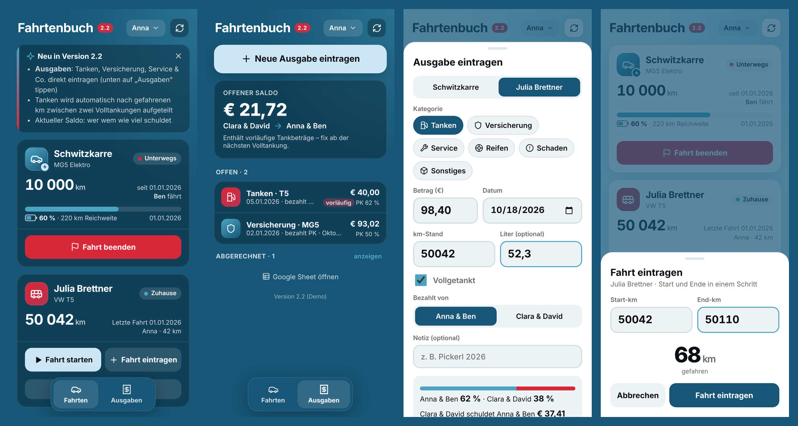

> Screenshots zeigen Demo-Daten. Echte Daten liegen ausschließlich im privaten Google Sheet.

---

## Inhalt

- [Funktionen](#funktionen)
- [Screenshots](#screenshots)
- [So werden Kosten aufgeteilt](#so-werden-kosten-aufgeteilt)
- [Für Mitfahrende: App einrichten](#für-mitfahrende-app-einrichten)
- [Architektur](#architektur)
- [Einrichtung & Betrieb](#einrichtung--betrieb)
- [API](#api)
- [Datenmodell](#datenmodell)
- [Entwicklung](#entwicklung)
- [Roadmap](#roadmap)

---

## Funktionen

**Fahrten**
- Fahrt **starten** und später **beenden** – oder **direkt eintragen** (Start + Ende in einem Schritt)
- Gefahrene km werden **live berechnet**; Plausibilitätsprüfung (Ende < Start, Lücken, > 3.000 km)
- Status pro Auto: zuhause / unterwegs (mit wem, seit wann), letzter km-Stand
- MG5: **Akkustand und Reichweite** (aus dem Smarthome, Tab `MG5-Data`)
- Spalte „Differenz" wird als Formel `=Cx-Bx` geschrieben → Korrekturen rechnen automatisch durch
- Bedienung auch per **Siri / Apple-Kurzbefehle** (über die bestehende Apps-Script-Web-App)

**Ausgaben** *(ab v2.2)*
- Tanken, Versicherung, Service, Reifen, Schaden, Sonstiges erfassen
- **Tanken** wird automatisch **nach gefahrenen km zwischen zwei Volltankungen** aufgeteilt
- **Offener Saldo**: wer schuldet wem wie viel
- Live-Vorschau der Aufteilung im Formular; Bearbeiten und Löschen offener Buchungen
- Alle Altbuchungen migriert (fixe Anteile, Status offen / abgerechnet)

**Allgemein**
- Als **App auf dem Home-Bildschirm** installierbar (eigenes Icon, kein Browser-Rahmen, kein Google-Banner)
- **Hell- und Dunkelmodus** folgen der Systemeinstellung
- Einmalige Namensauswahl pro Gerät; Zugriff nur mit Zugangsschlüssel im Link

---

## Screenshots

| | Dunkel | Hell |
|---|---|---|
| **Start** | 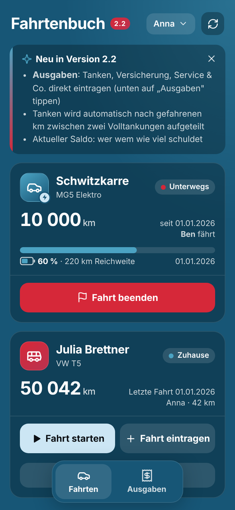 | 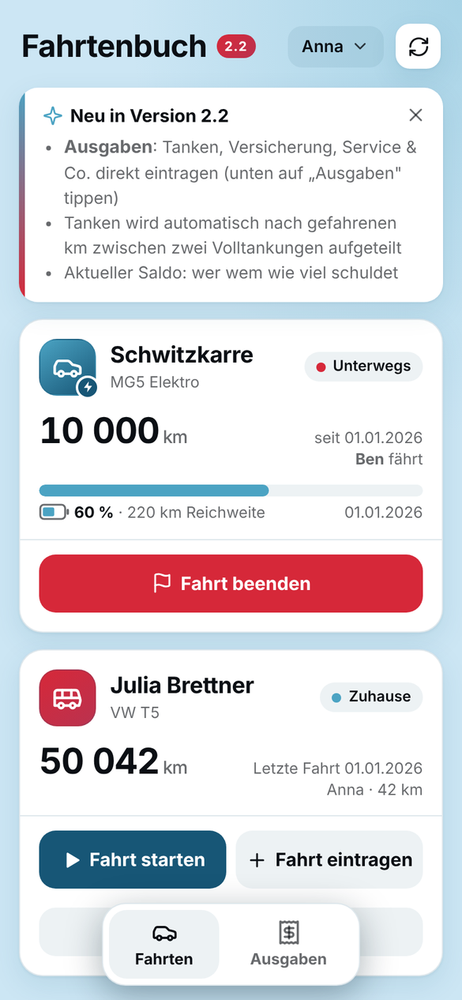 |
| **Fahrt eintragen** | 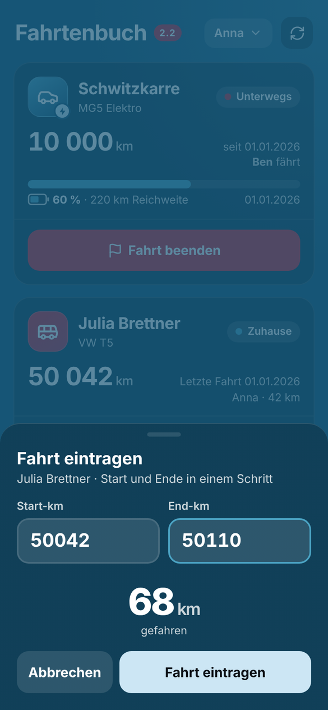 | 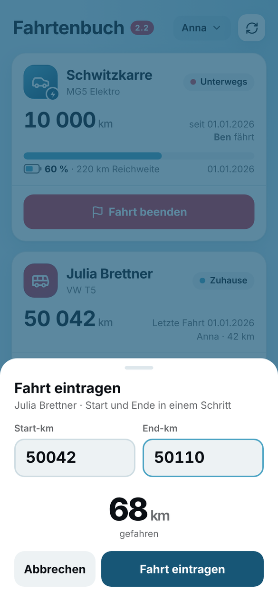 |
| **Ausgaben & Saldo** | 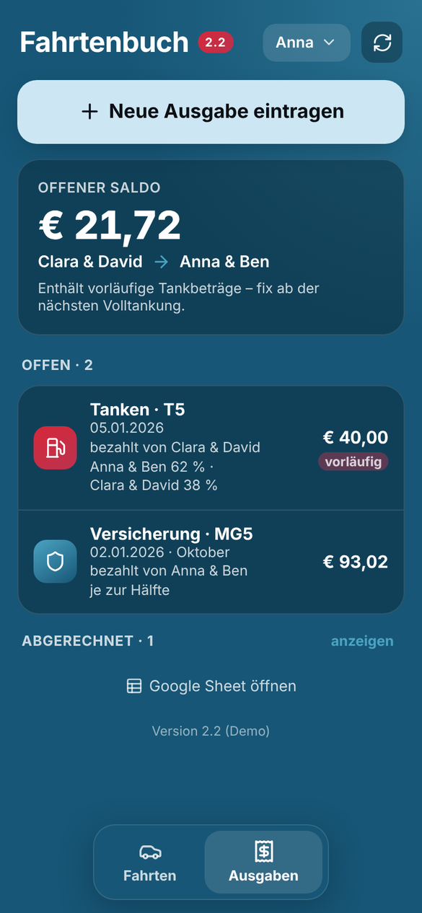 | 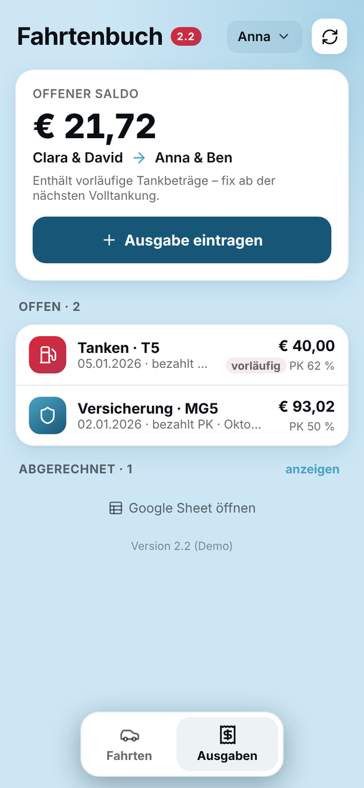 |
| **Tanken eintragen** | 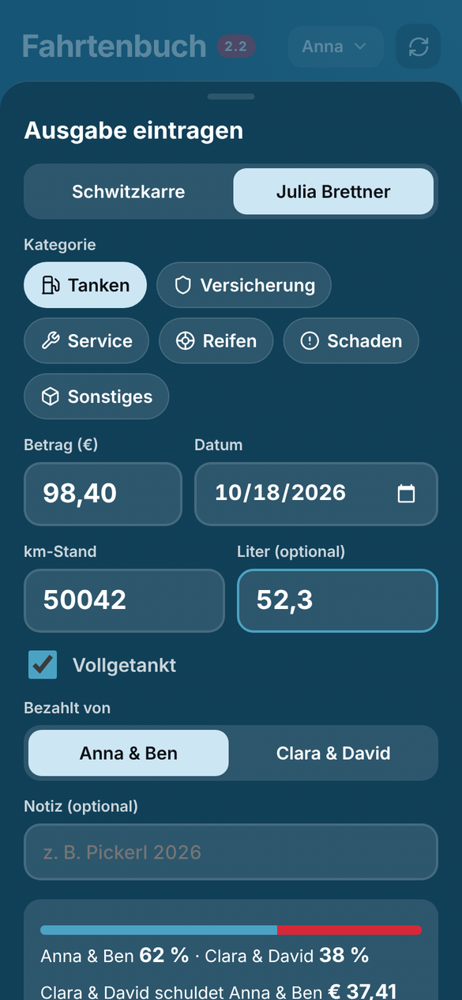 | 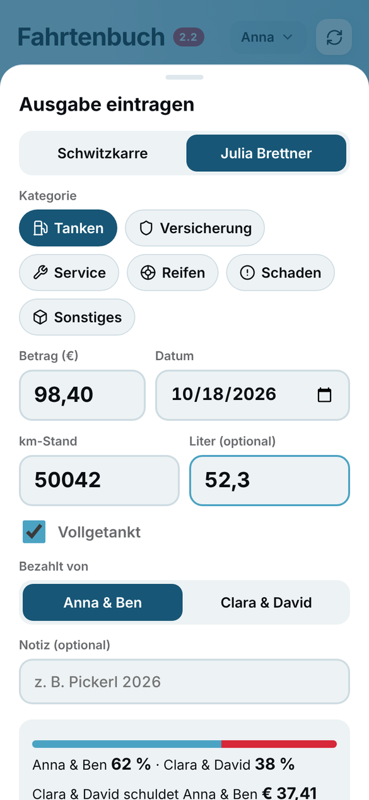 |
| **Aufteilungs-Vorschau** | 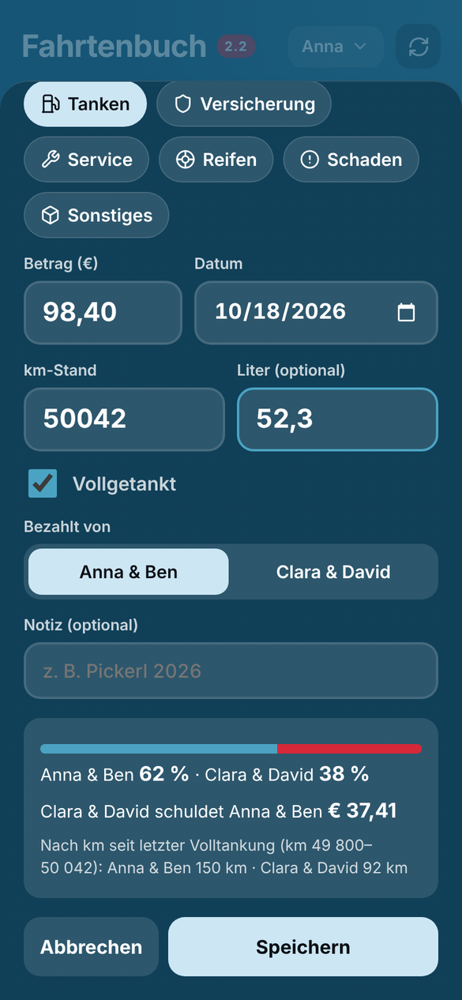 | 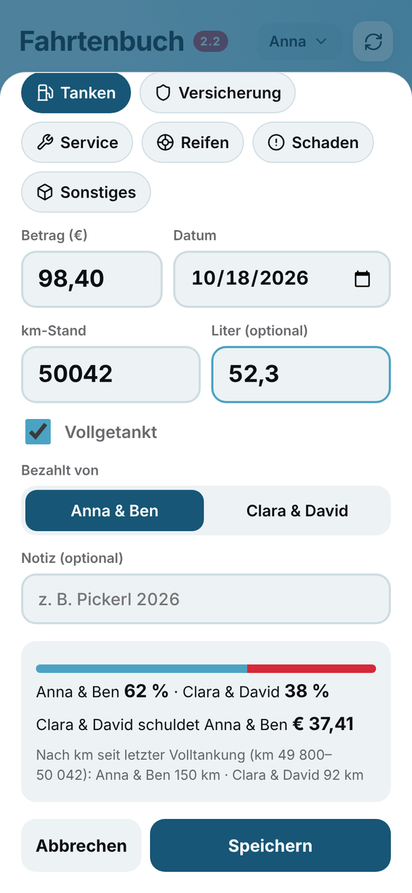 |
| **Namensauswahl** | 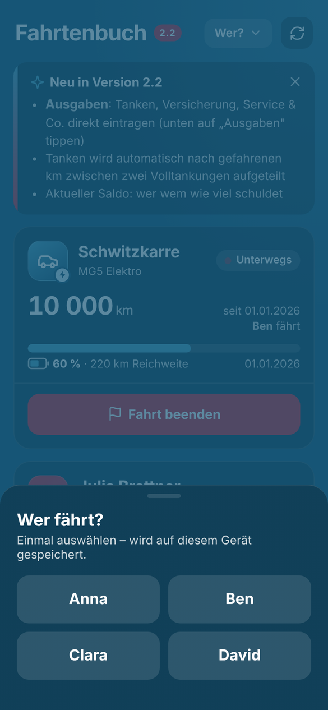 | 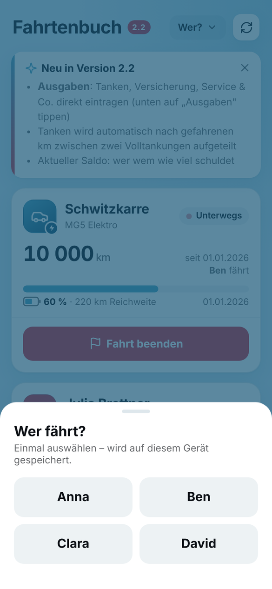 |

---

## So werden Kosten aufgeteilt

Grundlage ist der Vertrag zur gemeinschaftlichen Nutzung (§3). Abgerechnet wird zwischen den beiden **Haushalten** – wer tankt oder zahlt, legt aus der Haushaltskasse aus. In App und Sheet stehen die Haushalte ausgeschrieben (z. B. „Anna & Ben"); intern verwendet die API die Kürzel `PK` / `TM`.

| Kategorie | Fahrzeug | Aufteilung |
|---|---|---|
| ⛽ Tanken | T5 | nach km zwischen zwei Volltankungen |
| 🛡️ Versicherung, Vignette, Pickerl | beide | 50 : 50 |
| 🔧 Service / Reparatur | beide | 50 : 50 (pro Buchung änderbar) |
| 🛞 Reifen, Schneeketten | beide | 50 : 50 |
| 💥 Schaden | beide | 100 % Verursacher-Haushalt |
| 📦 Sonstiges | beide | wählbar: 50 : 50 / nur PK / nur TM |
| 🔌 Laden MG5 | MG5 | *derzeit nur Altdaten – künftig automatisch über Node-RED* |

### Tanken: Aufteilung nach km

```
 Volltankung        Teiltankung        Volltankung
 km 50.000  ──────  km 50.320  ──────  km 50.600
     │                   │                   │
     └──── 600 km: PK 264 km (44 %) · TM 336 km (56 %) ────┘
           Beide Tankbeträge werden 44 : 56 aufgeteilt.
```

- Maßgeblich ist der **km-Stand beim Tanken** (nicht das Datum); Fahrten über eine Tankgrenze werden anteilig gezählt.
- Tankungen nach der letzten Volltankung sind **vorläufig** und werden bei der nächsten Volltankung fixiert.
- Startpunkt der neuen Logik ist eine **Anker-Volltankung** aus den Altdaten.

### Saldo

Pro Buchung: zahlt PK, schuldet TM den TM-Anteil – und umgekehrt. Der offene Saldo ist die Summe über alle Buchungen mit Status `offen`.
Ein positiver Wert bedeutet *TM schuldet PK*, ein negativer *PK schuldet TM*.

---

## Für Mitfahrende: App einrichten

1. Den **Link aus der Gruppe** öffnen (enthält `?k=…`).
2. Einmal den **eigenen Namen** wählen.
3. iPhone: **Teilen → „Zum Home-Bildschirm"**. Die installierte App hat eigenen Speicher – dort den Namen einmal neu wählen.
4. Name ändern: oben rechts auf den Namen tippen.

---

## Architektur

```
 ┌──────────────────────────┐        fetch (JSON)       ┌──────────────────────────┐
 │  GitHub Pages            │ ────────────────────────▶ │  Apps Script             │
 │  index.html (diese Repo) │   ?key=… / POST text/plain │  „Fahrtenbuch API"       │
 │  PWA, Hell/Dunkel        │ ◀──────────────────────── │  api/Code.gs             │
 └──────────────────────────┘                            │  ausgeführt als Besitzer │
                                                         └────────────┬─────────────┘
 ┌──────────────────────────┐                                         │
 │  Apps Script             │  Siri / Kurzbefehle                     ▼
 │  „Fahrtenbuch" (alt)     │ ─────────────────────────▶  ┌──────────────────────────┐
 │  doPost für Shortcuts    │                             │  Google Sheet (privat)   │
 └──────────────────────────┘                             │  Fahrtenbücher, Buchungen│
 ┌──────────────────────────┐   MG5-Akku/Reichweite       │  MG5-Data, Summen …      │
 │  Smarthome (Node-RED)    │ ─────────────────────────▶  └──────────────────────────┘
 └──────────────────────────┘
```

- **Frontend**: eine einzige `index.html` ohne Build-Schritt, Icons als Inline-SVG, Schrift SF Pro (Apple) bzw. Inter.
- **API**: eigenes Apps-Script-Projekt, *Ausführen als: Ich*, *Zugriff: Jeder*, geschützt über einen Schlüssel.
- **Daten**: ausschließlich im privaten Google Sheet. Im Repo stehen weder Daten noch Schlüssel noch Sheet-ID.
- Die alte Apps-Script-Web-App bleibt für Siri-Kurzbefehle parallel in Betrieb.

---

## Einrichtung & Betrieb

### API-Projekt (einmalig)

1. [script.new](https://script.new) → Projekt **Fahrtenbuch API**.
2. Inhalt von [`api/Code.gs`](api/Code.gs) einfügen.
3. ⚙️ Projekteinstellungen:
   - Zeitzone **Europe/Vienna**
   - Skripteigenschaft **`SHEET_ID`** = ID des Google Sheets (aus der Sheet-URL zwischen `/d/` und `/edit`)
   - Skripteigenschaft **`HOUSEHOLDS`** = Personen und Haushalte als JSON, z. B.
     `{"Anna":"PK","Ben":"PK","Clara":"TM","David":"TM"}`
4. Funktion **`setup`** ausführen → `API_KEY` steht im Ausführungsprotokoll.
5. **Bereitstellen → Neue Bereitstellung → Web-App**: Ausführen als **Ich**, Zugriff **Jeder**.
6. `/exec`-URL in `index.html` bei `API_URL` eintragen.

### Update der API

1. Neuen `api/Code.gs` einfügen und speichern.
2. Bei Änderungen an Ausgaben einmal **`recomputeExpenses`** ausführen (einmalig bei v2.2: **`migrateLabels`** – schreibt die Haushalte im Sheet aus).
3. **Bereitstellungen verwalten → ✏️ → Neue Version** (URL bleibt gleich).

### Update der Oberfläche

Push auf `main` → GitHub Pages veröffentlicht automatisch nach ~1 Minute.

### Schlüssel wechseln

Skripteigenschaft `API_KEY` löschen → `setup` ausführen → neuen Link verteilen.

---

## API

Alle Antworten sind JSON, Fehler immer als `{ "ok": false, "error": "…" }`.

### GET

| Aufruf | Antwort |
|---|---|
| `?key=…&action=all` | `version`, `drivers`, `households`, `hhLabels`, `sheetUrl`, `cars[]` |
| `?key=…&action=expenses` | `expenses[]`, `saldo`, `saldoProvisional`, `tankWindow`, `categories` |

### POST (`Content-Type: text/plain`, JSON im Body)

Jeder Aufruf enthält `key` und `driver` (Name aus `drivers`).

| `action` | Felder | Wirkung |
|---|---|---|
| `start` | `sheet`, `startKM?` | Fahrt starten |
| `end` | `sheet`, `endKM`, `startKM?` | offene Fahrt beenden **oder** komplette Fahrt direkt eintragen |
| `addExpense` | `expense{ car, cat, amount, date, payer, split?, km?, liter?, full?, note? }` | Buchung anlegen |
| `updateExpense` | `id`, `expense{…}` | Buchung ändern (nicht bei `abgerechnet`) |
| `deleteExpense` | `id` | Buchung löschen (nicht bei `abgerechnet`) |

`split`: `km` (nur Tanken) · `50:50` · `PK` · `TM` · `fix` (Altdaten).

---

## Datenmodell

**Fahrtenbücher** (je Auto ein Tab): `Datum | Start-km | End-km | Differenz (=C-B) | Fahrer:in`

**Tab `Buchungen`**

| Spalte | Inhalt |
|---|---|
| A | ID |
| B | Datum |
| C | Fahrzeug |
| D | Kategorie |
| E | Betrag |
| F | Bezahlt von (Haushalt ausgeschrieben) |
| G | Aufteilung (`nach km`, `je zur Hälfte`, `nur <Haushalt>`, `fix`) |
| H | Anteil erster Haushalt (nur bei `fix`) |
| I | km-Stand (Tanken) |
| J | Liter |
| K | Vollgetankt |
| L | Notiz |
| M | Status (`offen` / `abgerechnet`) |
| N–P | Erfasst von, Geändert von, Geändert am |
| Q | Anteil erster Haushalt (berechnet, von der API geschrieben) |
| R | Ausgleich (+ TM→PK / − PK→TM, von der API geschrieben) |

---

## Entwicklung

```bash
# lokal mit Demo-Daten (kein API-Zugriff nötig)
python3 -m http.server 8000
open "http://localhost:8000/?demo"
```

```
.
├── index.html             # komplette App (HTML, CSS, JS)
├── manifest.webmanifest   # PWA / Home-Bildschirm
├── icon-*.png             # App-Icons
├── api/
│   ├── Code.gs            # Apps-Script-API
│   └── appsscript.json    # Manifest (Zeitzone, Web-App-Einstellungen)
└── docs/                  # Screenshots für diese README
```

- Neue Features werden **nur** in dieser Version gebaut (nicht mehr in der alten Apps-Script-Oberfläche).
- **Keine Daten, Namen, Schlüssel oder Sheet-IDs** committen – das Repo ist öffentlich. Alles Private liegt in den Skripteigenschaften der API.

---

## Roadmap

Gepflegt als [GitHub Issues](../../issues) mit den Milestones **Phase 1** und **Phase 2**.

| Phase 1 | Status |
|---|---|
| Ausgaben eintragen | ✅ v2.2 |
| Migration Altdaten | ✅ v2.2 |
| Statistik-Seite | ⏳ |
| Vertragsseite: Auflösung simulieren | ⏳ |

**Phase 2:** Siri „Tankung eintragen" · Quartalsabrechnung · Lücken-Seite · Fixkosten/Versicherung · MG5-Laden über Node-RED · Erinnerungen · Reservierungskalender · Belegfoto

---

## Versionen

| Version | Neu |
|---|---|
| **2.2** | Ausgaben, Saldo, Tank-Aufteilung nach km, Migration der Altbuchungen |
| **2.1** | Eigene Oberfläche auf GitHub Pages (ohne Google-Banner), Namensauswahl, Home-Bildschirm-App |
| **2.0** | Fahrt direkt eintragen, Live-km-Berechnung, Plausibilitätsprüfung, neues Design, Hell/Dunkel |
